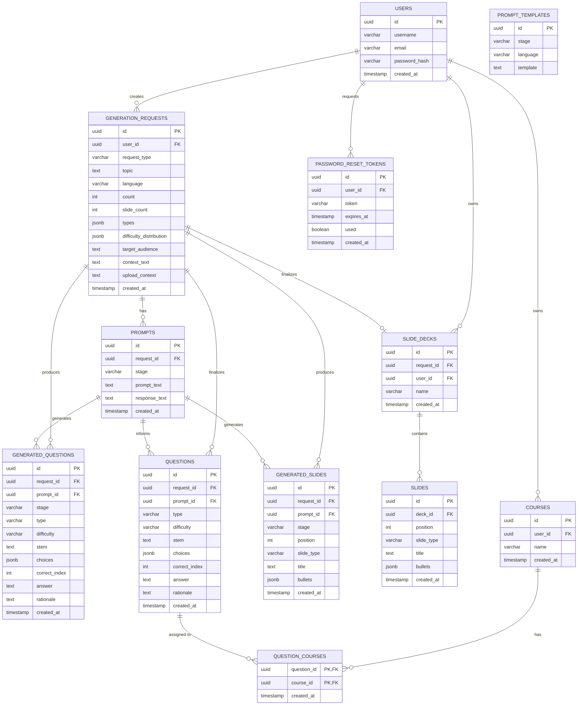
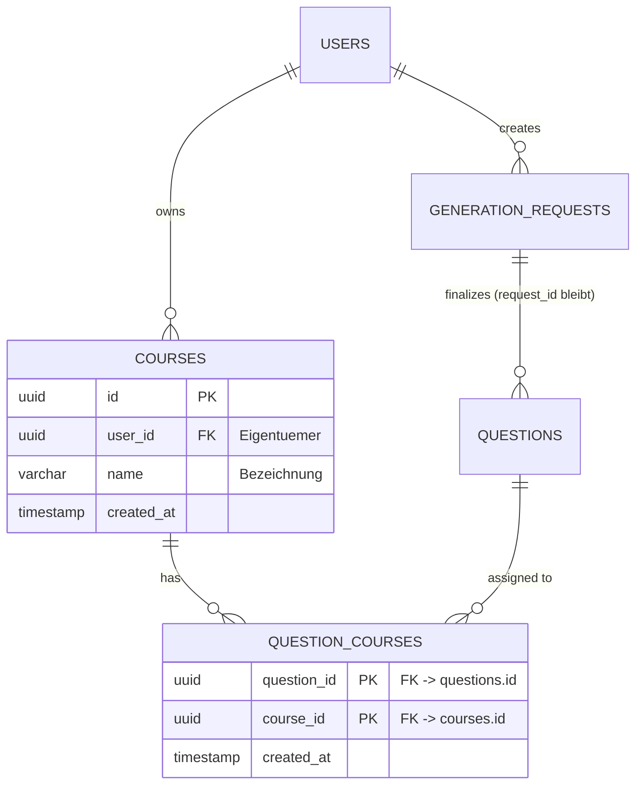

# Datenbank-Dokumentation

## Überblick

Die Datenbank verwendet PostgreSQL mit UUID als Primärschlüssel. Das Schema speichert Generation-Requests, Prompts, temporär generierte Fragen und Folien, finalisierte Fragen im Archiv, Foliensammlungen (Decks) sowie Prompt-Templates für beide Generierungslinien (Fragen und Folien).

## Entity-Relationship-Diagramm



## Tabellenbeschreibung

### users

Basistabelle für authentifizierte User. Alle Generation-Requests und Slide-Decks sind einem User zugeordnet.

**Hauptfelder:** `id`, `username`, `email`, `password_hash`, `created_at`

### generation_requests

Speichert alle Anfragen zur Fragen- und Folien-Generierung. Dieselbe Tabelle wird für beide Generierungslinien genutzt; `request_type` unterscheidet, um welche Art es sich handelt.

| Feld | Fragen-Request | Slides-Request |
|---|---|---|
| `request_type` | `'questions'` | `'slides'` |
| `count` | Anzahl der gewünschten Fragen | wird auf Default `1` gesetzt (ignoriert) |
| `slide_count` | `NULL` | Anzahl der gewünschten Folien |
| `types` | `["MCQ", ...]` | `[]` (ignoriert) |
| `difficulty_distribution` | `{easy, medium, hard}` | `NULL` (ignoriert) |
| `context_text` / `upload_context` | optional | optional |

`request_type` ist durch einen DB-Constraint auf `'questions'` und `'slides'` beschränkt. Die automatische Zuweisung erfolgt in `generation_repo.py` via `isinstance`-Prüfung — der Aufrufer muss nichts explizit setzen.

**Hauptfelder:** `id`, `user_id`, `request_type`, `topic`, `language`, `count`, `slide_count`, `types`, `difficulty_distribution`, `target_audience`, `context_text`, `upload_context`, `created_at`

### prompt_templates

Speichert Jinja2-Templates für die drei Generierungs-Stages (SKELETON, CONTENT, IMPROVE) in verschiedenen Sprachen (de, en).

**Hauptfelder:** `id`, `stage`, `language`, `template`

### prompts

Speichert den gerenderten Prompt-Text und die rohe LLM-Response für jeden Request und jede Stage. Bei mehreren Retry-Versuchen entsteht pro Versuch eine eigene Zeile.

**Hauptfelder:** `id`, `request_id`, `stage`, `prompt_text`, `response_text`, `created_at`

### generated_questions

Temporärer Speicher für Fragen während des Generierungsprozesses. Jede Zeile gehört zu genau einer Stage (`SKELETON`, `CONTENT` oder `IMPROVE`).

**Wichtig:** Diese Tabelle enthält Zwischendaten. Nach der Finalisierung werden die Fragen nach `questions` übertragen und hier gelöscht.

**Hauptfelder:** `id`, `request_id`, `prompt_id`, `stage`, `type`, `difficulty`, `stem`, `choices`, `correct_index`, `answer`, `rationale`, `created_at`

### questions

Finalisierte Fragen im Archiv. Struktur ähnlich wie `generated_questions`, aber ohne `stage`-Feld.

**Unterschied zu generated_questions:**

- Kein `stage`-Feld (Frage ist bereits finalisiert)
- Enthält nur dauerhaft gespeicherte Fragen

**Hauptfelder:** `id`, `request_id`, `prompt_id`, `type`, `difficulty`, `stem`, `choices`, `correct_index`, `answer`, `rationale`, `created_at`

### generated_slides

Temporärer Speicher für Folien während des Generierungsprozesses. Jede Zeile gehört zu genau einer Stage (`SLIDES_OUTLINE`, `SLIDES_CONTENT` oder `SLIDES_IMPROVE`) und repräsentiert genau eine Folie mit ihrer Position im Deck.

`bullets` ist ein JSONB-Array aus Strings (z. B. `["Erster Punkt", "Beispiel: ..."]`). Bei `SLIDES_OUTLINE`-Zeilen ist `bullets` typischerweise `NULL`, da die Outline-Stage nur Titel und Folientyp erzeugt.

**Wichtig:** Diese Tabelle enthält Zwischendaten. Nach dem Finalisieren eines Decks werden die Folien nach `slides` übertragen.

**Hauptfelder:** `id`, `request_id`, `prompt_id`, `stage`, `position`, `slide_type`, `title`, `bullets`, `created_at`

### slide_decks

Finalisierte Foliensammlung eines Users. Jedes Deck gehört einem User und verweist optional auf den ursprünglichen `generation_requests`-Eintrag (`ON DELETE SET NULL`).

**Hauptfelder:** `id`, `request_id`, `user_id`, `name`, `created_at`

### slides

Einzelne Folien eines finalisierten Decks. Enthält dieselben Inhaltsfelder wie `generated_slides`, aber ohne `stage` / `request_id` / `prompt_id` – stattdessen verknüpft über `deck_id`.

`slide_type` kann `"title"`, `"content"` oder `"closing"` sein. `bullets` ist ein JSONB-Array aus Strings.

**Hauptfelder:** `id`, `deck_id`, `position`, `slide_type`, `title`, `bullets`, `created_at`

### password_reset_tokens

Einmal-Tokens für die "Passwort vergessen"-Funktion. Gehört fachlich zum Auth-Flow und nicht zum Generierungs-Kern.

**Hauptfelder:** `id`, `user_id`, `token`, `expires_at`, `used`, `created_at`

## Datenfluss

### Fragen-Generierung

1. **Generierung:** `generation_requests` → `prompts` (pro Stage: `SKELETON`, `CONTENT`, `IMPROVE`) → `generated_questions`
2. **Finalisierung:** `generated_questions` → `questions` (neue `Question`-Zeilen werden angelegt, alle zugehörigen `GeneratedQuestion`-Zeilen werden gelöscht)
3. **Archiv:** Finalisierte Fragen bleiben in `questions` und sind über `request_id` mit `generation_requests` verknüpft

### Folien-Generierung

1. **Generierung:** `generation_requests` → `prompts` (pro Stage: `SLIDES_OUTLINE`, `SLIDES_CONTENT`, `SLIDES_IMPROVE`) → `generated_slides`
2. **Finalisierung:** `generated_slides` → `slide_decks` + `slides` (ein Deck pro Request, eine Folie pro `GeneratedSlide` der letzten Stage)
3. **Archiv:** Finalisierte Decks bleiben in `slide_decks`/`slides` und sind über `user_id` im Deck fest zugeordnet

## Prompt-Templates

Die `prompt_templates`-Tabelle enthält vordefinierte Jinja2-Templates. Die Zuordnung erfolgt über das Paar (`stage`, `language`).

### Fragen

- **SKELETON** (`de` / `en`): Erstellt Strukturgerüst mit Fragetypen und Schwierigkeitsgraden
- **CONTENT** (`de` / `en`): Generiert vollständige Fragen auf Basis des Gerüsts
- **IMPROVE** (`de` / `en`): Optimiert Fragen sprachlich und didaktisch

Gebräuchliche Variablen: `{{topic}}`, `{{count}}`, `{{types}}`, `{{difficulty_distribution}}`, `{{skeleton_data}}`, `{{questions_raw}}`, `{{language}}`, optional `{{context_text}}` / `{{upload_context}}`.

### Folien

- **SLIDES_OUTLINE** (`de` / `en`): Erstellt die Gliederung einer Präsentation (Titel, Position, Folientyp pro Folie)
- **SLIDES_CONTENT** (`de` / `en`): Erzeugt die vollständigen Folieninhalte (Bullets) auf Basis der Outline; 3–7 Bullets je Inhaltsfolie, mind. 30 % mit Beispiel
- **SLIDES_IMPROVE** (`de` / `en`): Optimiert Folien sprachlich und didaktisch, ohne Folienanzahl, Reihenfolge oder Folientyp zu verändern

Gebräuchliche Variablen: `{{topic}}`, `{{slide_count}}`, `{{language}}`, `{{outline_data}}`, `{{slides_raw}}`, optional `{{context_text}}` / `{{upload_context}}`.

### Retry-Feedback

Jedes Template enthält einen optionalen ``-Block, der bei fehlgeschlagenen Validierungen im nächsten Versuch die Fehlermeldung (`{{previous_error}}`) und die Versuchsnummer (`{{attempt}}`) in den Prompt einspeist. So kann das LLM den Fehler gezielt korrigieren, statt denselben Output erneut zu produzieren.

## Lehrveranstaltungen (LV) – Zuordnung von Fragen

> **Status: Grundsatzentscheidung von der Product Ownerin bestätigt (Datum: 01.11.2026).**
> Beschlossen sind die drei Punkte aus Abschnitt 2 (N:M, Fragen ohne LV erlaubt, LV nur mit Bezeichnung). Alles unter „Noch offen“ (Abschnitt 8) ist weiterhin **nicht** beschlossen.
> Grundlage für [SCRUM-7](https://technikum-wien-team-epwyp8qf.atlassian.net/browse/SCRUM-7) und [SCRUM-8](https://technikum-wien-team-epwyp8qf.atlassian.net/browse/SCRUM-8).

### 1. Ist-Zustand: Beziehung requests ↔ questions

```
users 1──n generation_requests 1──n prompts 1──n generated_questions   (temporär)
                       │
                       └──────────n questions                           (final, Archiv)
```

- `generation_requests` gehört über `user_id` einem User.
- `generated_questions` sind Zwischendaten; bei `POST /api/finalize` werden sie als `questions` übernommen und gelöscht.
- Finalisierte `questions` behalten ihre `request_id`. Es gibt **kein** `user_id` an `questions`; der Besitzer wird immer über `questions.request_id → generation_requests.user_id` ermittelt (so auch in `routes_archive.py` und `archive_read_service.py`).
- Das Archiv ist nach `request_id` („Thema“) gruppiert. Löschen eines Archiv-Eintrags löscht den `generation_request` und damit per `ON DELETE CASCADE` alle Fragen.

### 2. Entscheidung: keine bis mehrere LVs pro Frage (N:M)

| Variante | Bedeutung | Umsetzung |
|---|---|---|
| A | keine oder genau eine LV | optionales `course_id` auf `questions` |
| **B (beschlossen)** | **keine bis mehrere LVs** | **Zuordnungstabelle `question_courses`** |

**Entscheidung: Variante B (von der Product Ownerin bestätigt).**

Begründung:

- Dieselbe Frage kann in Mathematik *und* Statistik sinnvoll sein. Mit Variante A müsste sie kopiert werden. Kopien laufen auseinander (eine Korrektur müsste doppelt gepflegt werden) und `request_id` wäre nicht mehr eindeutig der Quelle zugeordnet.
- Variante B ändert **keine** bestehende Tabelle. `questions` und `generation_requests` bleiben unverändert, Request-IDs und bisherige Archivaufrufe sind damit nicht berührt.
- „Eine LV“ ist in Variante B ein Sonderfall (eine Zeile). Eine spätere Einschränkung wäre einfacher als eine nachträgliche Erweiterung von A auf mehrere LVs (Migration + API-Bruch).
- Nachteil: etwas mehr Aufwand bei Abfragen (ein Join) und in der UI (Mehrfachauswahl).

**Entscheidung der Product Ownerin:**

| Frage | Antwort |
|---|---|
| Darf dieselbe Frage mehreren LVs zugeordnet sein, ohne kopiert zu werden? | **Ja** |
| Dürfen Fragen ohne LV existieren? | **Ja** (Startzustand aller bestehenden Fragen) |
| Reicht eine LV mit Bezeichnung, oder braucht sie LV-Nummer/Semester? | **Nur die Bezeichnung** |

### 3. Eigentümer (Benutzertrennung)

- Eine LV gehört genau einem User (`courses.user_id`), analog zu `slide_decks.user_id`.
- Eine Zuordnung ist nur erlaubt, wenn **beides** zutrifft:
    1. `courses.user_id = aktueller User`
    2. Besitzer der Frage (über `questions.request_id → generation_requests.user_id`) = aktueller User
- Es gibt **keine** benutzerübergreifende Freigabe und keine Übertragung von LVs. Das wird nicht stillschweigend eingeführt; falls gewünscht, ist es ein eigenes Ticket.
- Zwei verschiedene User dürfen gleich benannte LVs haben (Eindeutigkeit gilt pro User).
- Wird ein User gelöscht, werden seine LVs und deren Zuordnungen per `CASCADE` entfernt (Fragen werden ohnehin über die Requests mitgelöscht).
- Die Prüfung erfolgt in der Service-Schicht (wie bisher in `routes_archive.py`), nicht nur im Frontend.

### 4. Modellskizze



**Gewählte Variante (beschlossen): B – Zuordnungstabelle `question_courses`.** Variante A (optionales `questions.course_id`) wird nicht umgesetzt.

### 5. Tabellen

#### courses

| Feld | Typ | Regel |
|---|---|---|
| `id` | UUID PK | `uuid_generate_v4()` |
| `user_id` | UUID NOT NULL | FK → `users(id)` `ON DELETE CASCADE`, Index |
| `name` | VARCHAR(255) NOT NULL | getrimmt, nicht leer; eindeutig pro User (ohne Beachtung von Groß-/Kleinschreibung) |
| `created_at` | TIMESTAMPTZ | Default `now()` |

#### question_courses

| Feld | Typ | Regel |
|---|---|---|
| `question_id` | UUID NOT NULL | FK → `questions(id)` `ON DELETE CASCADE` |
| `course_id` | UUID NOT NULL | FK → `courses(id)` `ON DELETE CASCADE` |
| `created_at` | TIMESTAMPTZ | Default `now()` |

Primärschlüssel: (`question_id`, `course_id`) – verhindert doppelte Zuordnung. Zusätzlicher Index auf `course_id` für die Filterung.

### 6. Regeln

| Situation | Verhalten |
|---|---|
| Bestehende Fragen | starten ohne LV; die Migration legt **keine** Zuordnungen an |
| Neu finalisierte Fragen | starten ohne LV (Zuordnung erfolgt danach separat) |
| Frage ohne LV | gültig; wird im Archiv normal angezeigt, ist per Filter `unassigned=true` auffindbar |
| Zuordnung entfernen | löscht nur die Zeile in `question_courses`, **nie** die Frage |
| LV löschen | `CASCADE` entfernt nur die Zuordnungen; Fragen bleiben bestehen und sind danach ggf. ohne LV |
| Frage löschen (z. B. Archiv-Eintrag löschen) | Zuordnungen verschwinden per `CASCADE`; die LV bleibt bestehen |
| Request-IDs | unverändert, `questions.request_id` wird nicht angefasst |
| Bisherige Archivaufrufe | `GET /api/archive/topics` ohne neue Parameter und `GET /api/archive/{request_id}/questions` liefern dasselbe wie bisher (neue Antwortfelder sind nur zusätzlich) |

### 7. Vorlage für SCRUM-7 (SQL)

Für neue Datenbanken in `db-init/01_tables.sql` ergänzen, für bestehende Datenbanken als separate Migration ausführen (die `db-init`-Skripte laufen nur bei leerer DB):

```sql
CREATE TABLE IF NOT EXISTS courses (
    id UUID PRIMARY KEY DEFAULT uuid_generate_v4(),
    user_id UUID NOT NULL REFERENCES users(id) ON DELETE CASCADE,
    name VARCHAR(255) NOT NULL,
    created_at TIMESTAMP WITH TIME ZONE DEFAULT now(),
    CONSTRAINT chk_course_name_not_blank CHECK (length(btrim(name)) > 0)
);

CREATE INDEX IF NOT EXISTS idx_courses_user_id ON courses(user_id);
CREATE UNIQUE INDEX IF NOT EXISTS uq_courses_user_name ON courses(user_id, lower(name));

CREATE TABLE IF NOT EXISTS question_courses (
    question_id UUID NOT NULL REFERENCES questions(id) ON DELETE CASCADE,
    course_id UUID NOT NULL REFERENCES courses(id) ON DELETE CASCADE,
    created_at TIMESTAMP WITH TIME ZONE DEFAULT now(),
    PRIMARY KEY (question_id, course_id)
);

CREATE INDEX IF NOT EXISTS idx_question_courses_course_id ON question_courses(course_id);
```

SQLAlchemy-Modelle für `backend/app/models/sql_models.py`:

```python
from sqlalchemy import PrimaryKeyConstraint  # zusätzlich zu den bestehenden Imports

class Course(Base):
    __tablename__ = "courses"
    id = Column(Uuid, primary_key=True, default=uuid.uuid4)
    user_id = Column(Uuid, ForeignKey("users.id", ondelete="CASCADE"), nullable=False, index=True)
    name = Column(String(255), nullable=False)
    created_at = Column(TIMESTAMP(timezone=True), server_default=func.now())
    user = relationship("User")


class QuestionCourse(Base):
    __tablename__ = "question_courses"
    question_id = Column(Uuid, ForeignKey("questions.id", ondelete="CASCADE"), nullable=False)
    course_id = Column(Uuid, ForeignKey("courses.id", ondelete="CASCADE"), nullable=False, index=True)
    created_at = Column(TIMESTAMP(timezone=True), server_default=func.now())
    __table_args__ = (PrimaryKeyConstraint("question_id", "course_id"),)
```

### 8. Noch offen (nicht als beschlossen zu behandeln)

- Ob beim Finalisieren direkt LVs mitgegeben werden dürfen (Vorschlag: nein, erst nachträglich zuordnen).
- Ob Folien-Decks später ebenfalls LVs bekommen (nicht Teil dieses Tickets).
- Konkrete Schnittstelle (Feldnamen, Statuscodes): Abstimmung mit der API-Umsetzung in `docs/api.md`.
